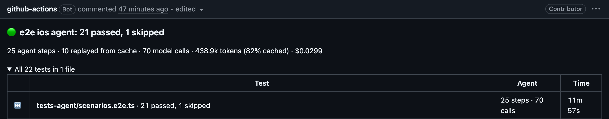

## what your team sees after every run.

  <Step compact index="01" title="pull request">On GitHub Actions, a comment on each pull request: results, flaky tests, replays, model calls and cost.</Step>
  <Step compact index="02" title="ci results">JUnit results in your CI's test view, next to the rest of your checks.</Step>
  <Step compact index="03" title="failures">A step-by-step trace with screenshots for every failure, kept with the CI run.</Step>

<!--
The screenshot is the top of a real comment posted by the @e2e-dev/github reporter on a pull request in the e2e repository (github.com/e2e-inc/e2e): 21 passed, 1 skipped, 25 agent steps, 10 replayed from cache, 70 model calls, $0.0299.
On GitHub Actions the reporter posts one comment per run and edits it on a rerun. On other CI systems you get JUnit in the CI's test view and a markdown summary.
Traces and screenshots are kept for failed and flaky tests by default. Video is opt-in.
-->
