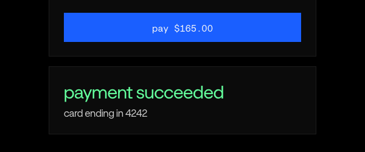

## a card payment in nested iframes.

<div class="real-test mt-[20px] grid grid-cols-[5fr_8fr] items-stretch gap-[40px]">
  <div class="flex flex-col justify-between">
    <p class="type-body-m">A test on e2e's official iframes example: a card checkout inside nested cross-origin iframes, like a hosted payment form. The agent fills it in like a user.</p>
    <div class="grid grid-cols-2 gap-[20px]">
      <div class="border-t border-e2e-neutral-700 pt-[20px]">
        <div class="type-statement !normal-case text-e2e-blank">55 s</div>
        <div class="e2e-caption mt-[8px]">first run<br>15 model calls</div>
      </div>
      <div class="border-t border-e2e-neutral-700 pt-[20px]">
        <div class="type-statement !normal-case text-e2e-blank">17 s</div>
        <div class="e2e-caption mt-[8px]">cached run<br>1 model call</div>
      </div>
    </div>
    
  </div>
<Terminal title="tests/card-payment.e2e.ts">

```ts
import { test } from "@e2e-dev/web";
import { expect } from "e2e";

test("a valid card is charged", async ({ app, agent, screen }) => {
  await app.open("/");
  await agent.act(
    "fill in the card form with name Ada Lovelace, card number " +
      "4242 4242 4242 4242, expiry 12/30, and CVC 123, " +
      "then click the Pay button",
  );
  await expect(screen.getByTestId("confirmed-last4")).toHaveText("4242");
  await agent.assert(
    'the page says "payment succeeded" for the card ending in 4242 ' +
      "and shows no error",
    { vision: true },
  );
});
```

</Terminal>
</div>

<style>
.real-test .terminal-body .slidev-code { font-size: 12px !important; line-height: 20px !important; }
</style>

<!--
Real runs of e2e's official iframes example (github.com/e2e-inc/e2e-iframes, listed on e2e.com/examples), measured in November 2026.
- First run: passed in 55 s with 15 model calls.
- Cached run: passed in 17 s with 1 model call, the final check. The fill-and-pay step replayed its recorded actions without the model.
Why this test: the card form lives in nested cross-origin iframes, like Stripe Elements or Adyen. A scripted test needs a locator for every frame, and it breaks when the provider changes its markup. The agent works from the screen and types like a user.
Better still: replace this slide with a test from your own project, and run it before the talk so the numbers are yours.
-->
